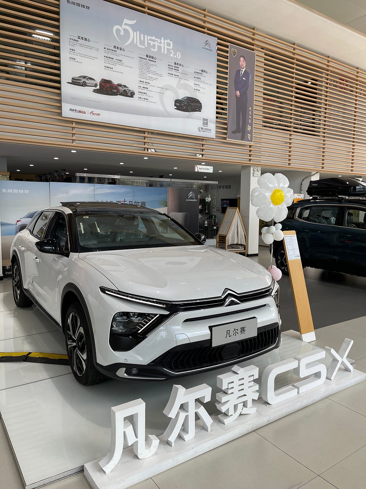
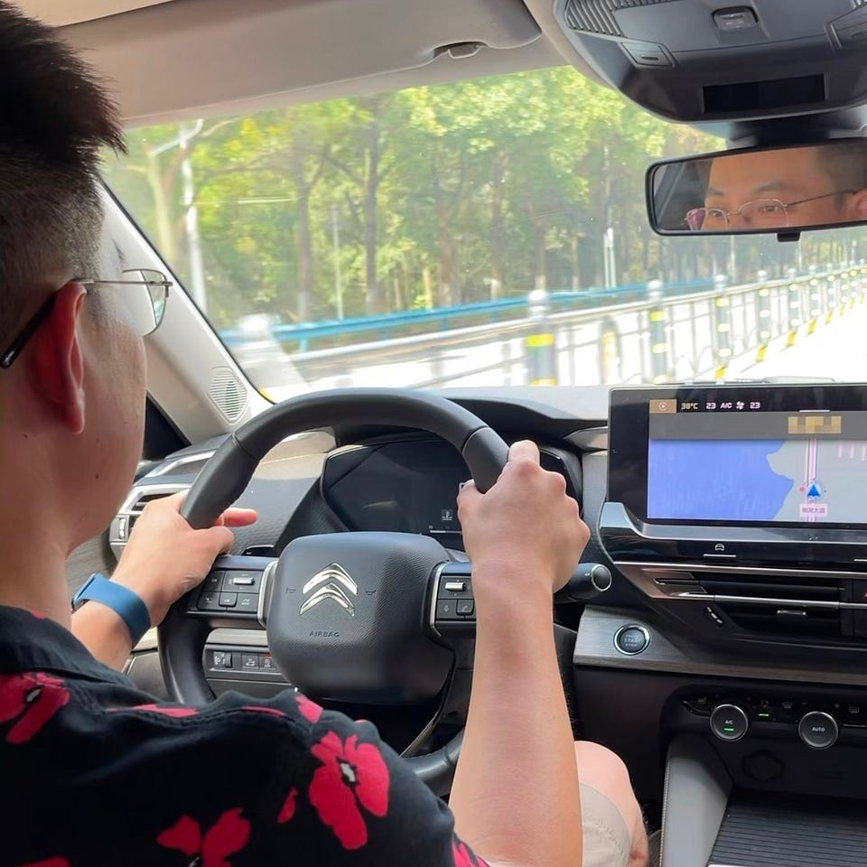
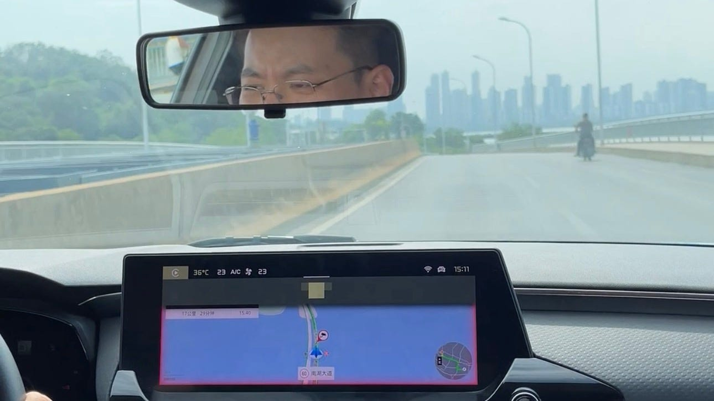

Welcome to late Autumn / early Holidays 🍂, my favorite season of the year filled with amber colors and pumpkin spice flavors, right as the first chord of Christmas music starts playing 🎄. A lot has happened to me in the past few months as I transitioned from school to a new career in a new industry while meeting more people on the sidelines.

This post also lives on [my Substack](https://junruren.substack.com/p/taste-and-product-fascination?utm_source=junruren.com&utm_medium=referral&utm_campaign=taste-and-product-fascination) — comment there, vote in the poll, or subscribe to get future posts by email.
{: .notice}

**In this post, I want to kick off a mini post series to keep myself on a more manageable posting habit while actually entertaining you, my dear reader.** I shall call this mini post series “*PM Skills\**” where in each post I want to share one skill that I am actively working on as my PM career rolls out; hence the asterisk “`*`”.[^1]

But first, a lightning update:

In August, I had the pleasure of guest speaking at an online PM roundtable hosted by my friend (and also Waymo colleague) [JJ Dai](https://www.linkedin.com/in/jjneversleeps/). JJ hosts these roundtables annually around peak recruiting seasons to help new and experienced product professionals navigate their own career paths and recruiting strategies. Guests are usually those who recently landed a PM job and have a lot to share. To be honest, I felt like an outlier at that event because, as revealed in [my last post](), I was only a month into my very first PM job, though I brought 6 years of engineering experience under my belt.

You can watch that all-Mandarin roundtable recording here: [YouTube](https://youtu.be/kKVR87icKQs?si=3FiYl_nw3HV3sSiY) / [BiliBili](https://www.bilibili.com/video/BV1R18C6xEtp).

While other guest speakers eloquently walked the audience through their best PM takeaways, recruiting checklists, or even resume tricks, I contributed a little 🤷‍♂️, but I am glad that I opened my introduction with a question to the entire Zoom room: “***Who else here, like me, is pivoting from R&D to product?***” Reactions over Zoom were lukewarm, but to my surprise, immediately after the event and in the months since, I’ve received a lot of outreach from peers who are like me: coming from a technical background and now considering if switching to product is the right move.

Now that I am a little over four months into my first PM job and have had the pleasure of speaking with a handful of peers who are also navigating the developer-to-PM jump, I thought I could pen down more recent learnings on the job and also in my life, as an amendment service to all the roundtable audience who heard so little from me in August 😅.

---

## “Taste”

Before naming my first *PM Skill\**, I want to start with a phrase I keep hearing almost every day, especially on podcasts and feeds, and plenty at work too: **product taste**.

Everyone seems to agree that good product taste matters. Yet most of the time it gets talked about like a black box: that sudden flash of intuition when someone looks at a product and just feels, *this is how it should be done*. As a former engineer used to taking AI models apart, I keep wanting to open that black box too. What is product taste actually made of, and how do we build it? (If you are curious what others actually mean by it, I put together an informal literature review in the appendix at the end.)

A working answer came to me on the fly during a recent call with one of the peers, Chloe Li, who reached out after watching that roundtable recording. When Chloe asked where product taste comes from, I started thinking out loud and landed on a small hot take: assuming the product is meant to be used by other humans, **the best way to form product taste is to understand humans better**. Ultimately, a PM is someone who needs to understand people. For those of us coming from R&D, here is the catch: understanding technology is usually the easy part, while understanding humans is very hard. Code and systems can be complicated, sure, but at least you can read the logic. We humans are far more complex creatures, and much harder to predict. In a remarkably similar vein, during a recent conversation with an AI researcher, I asked him, “How does one build their ‘research taste’?” to which he replied bluntly: “You have to know what hypes people up.” Bingo! Isn’t that effectively understanding humans better?

## PM Skills\* #1: Product Fascination

Even if we never fully figure people out (and probably do not need to go back to school for a psychology degree), we can still attempt various tactics to get a little closer. We can deal with all kinds of people, pick up odd subjects outside of tech, or even catch ourselves nitpicking an unclear street sign on a walk and spending ten seconds redesigning it in our head. Among those tactics, the lowest-effort starter as a junior PM is my first *PM Skill\**: **product fascination.** It will sound intuitive and perhaps trivial on paper, yet it is something I have unknowingly been practicing since my early engineering days, and I believe it built a foundation that supported my career pivot so far.

**Product fascination**, in my own words, refers to this subconscious habit of always using the final product that my company/team ships to the eventual mass market (whether it is B2B or B2C). Further, it’s not just using the actual products every day, but also being fascinated by both (a) how the company markets and tells stories about its products (a topic rich enough that I will save it for a future deep dive) and (b) how the market and customers react to and interact with them. Whenever your day-to-day work sits a step or two removed from the end customer, putting yourself where real people meet the finished product is the most direct way to see where your own assumptions about humans hold up or fall short. Looking back across my career, trying out the products I worked on in the wild taught me this long before I had a PM title.

The first project I took on when I joined SoundHound as a new grad software engineer in conversational AI was for Mandarin natural language capabilities that eventually shipped to [Citroën cars in China](https://www.soundhound.com/newsroom/soundhound-delivers-mandarin-voice-solution-for-dpca-vehicles-in-china).[^2] What we actually developed was an SDK that turns an uttered voice command into structured intents that the car manufacturer (or its head unit technology partner) needed to implement actual actions. For example, when a car owner says, “Set the AC temperature to 24 degrees Celsius and navigate to the nearest gas station,” our SDK would return a structured JSON representing the user’s two intents, including the desired climate control setting and navigation destination. But from there, I never had a chance to actually feel the breeze of a cooling AC or see an in-car screen already routing me to the nearest gas station. I was building it in California while the finished car was only integrated on the other side of the Pacific, which was an odd feeling.

Despite all the demo videos sent from our partners in China showing the voice recognition working, I always wanted to try everything myself. So in the summer of 2023, about one year after the launch of SoundHound-powered Citroën cars in China, I finally got to visit a Citroën dealership there and requested a test drive (a trip I mentioned briefly in my last post). I still feel so sorry for the sales guy who accompanied me as he watched me not caring at all about how the car drove, just talking nonstop to the car through hundreds of voice commands that I had known way too well. Yet it felt like a way-overdue full-circle moment: I finally understood all the bug reports, feature requests, and overnight fixes I had worked on over the past 5 years.

<figure>
  
  <figcaption>Citroën C5X shown inside a dealership in Wuhan! My first time seeing this car that I’ve worked indirectly on for years.</figcaption>
</figure>

<figure>
  
  <figcaption>I immediately got behind the wheel for a test drive, only to keep saying “Nihao Citroën…” Again I am deeply sorry for the salesperson who accompanied me for a sale never materialized…</figcaption>
</figure>

As a supplier, we were responsible only for the voice AI, and it was not until that piece was integrated into a bigger product used by the end user (the car owner or passenger, in this case) that I finally had the full context of where my “sub-product” fell short due to greater complexity and unforeseen edge cases. For instance, because the voice AI worked alongside the car’s own on-screen controls and maps, what a driver saw on screen did not always line up with what the voice assistant knew. Here is a made-up example, purely for illustration: when a driver asks to find a point of interest, the search results spoken back by our voice AI might not always align with what the head unit’s navigation software actually displays on the screen. That kind of gap created a discrepancy between the mental model we, the voice AI builders, had when envisioning the voice control experience and the mental model a driver actually formed in the car while looking at the screen and listening to the voice assistant at the same time.

<figure>
  
  <figcaption>My eye brows raised 🤨 when catching a voice command not recognized by the car</figcaption>
</figure>

I really wish I recored more videos of my dealership visit. The video below shows a rather successful run of all my voice commands being handled excellently by “Nihao Citroën 你好雪铁龙” (the wake word) as my commands didn’t involve much reliance on the display UI. In this video, I asked to set AC temperature, navigate to a nearby gas station, user memory (“remember that my work is at Wuhan University”), and lastly to tie it all together, “navigate to my work” which was beautifully fulfilled by starting navigation to Wuhan University. (Remember, all of this was built before LLM was a thing, and everything was expected to run locally on the car computer’s embedded system with extremely limited memory… So I sounded and was indeed pretty thrilled when all the voice commands worked.)

*(The video plays on [the Substack version of this post](https://junruren.substack.com/p/taste-and-product-fascination?utm_source=junruren.com&utm_medium=referral&utm_campaign=taste-and-product-fascination).)*

From that field trip to the dealership, I learned that it would have been great if I had spent more time designing a more thorough “contract” (API) to sync what was displayed in the car back to the voice AI model (i.e., sharing the “context,” or having a proper “MCP” in today’s LLM terms). The unintended confusion caused by mismatched mental models between developers and end users can be taxing.

I must have read about “mental models” a dozen times across books and essays. Still, nothing hit home as vividly as that little “gemba walk”[^3]: trying out the final product I had contributed to and discovering firsthand a mismatched mental model, along with how heavily we humans depend on ours.

Fast-forwarding to today, my product fascination shows up in the 40+ autonomous rides I have taken since joining Waymo, across multiple cities, day and night. Yes, I work on simulation, something entirely hidden from every rider, yet it is a critical evaluator and proving ground for autonomous driving capabilities before they reach the road.[^4] Through every pickup and drop-off, and by watching how other road users share the street with a driverless car, I have been building a much sharper sense of what simulation has to capture. Many of the abstract, nebulous concepts I first read about on paper slowly made sense once I connected them to real human behavior in the field.

Listening to how people react to autonomous vehicles has brought its own surprises. At a multi-school alumni picnic in San Francisco, I met a retired MIT couple, and when my work came up, the alumna told me candidly that she never feels comfortable crossing the street in front of a driverless car. When I asked why, she explained that whenever she approaches an intersection and sees one coming, she always waves it through first, preferring to wait until it clears the crosswalk before she crosses, even if that means dealing with human drivers afterward. That stopped me in my tracks, because I have heard so many other people say the exact opposite: that they feel especially comfortable crossing in front of an autonomous vehicle since they trust it to yield and wait until they are safely across. Even among fellow MIT alumni, trust in a new technology cannot be taken for granted, and two people standing at the same crosswalk can hold completely opposite mental models of what the car will do.

<figure>
  
  <figcaption>A stock image of Waymo stopping for crosswalk from <a href="https://waymo.com/waymo-driver/#:~:text=closed%20course%20environments.-,Public%20roads,our%20performance%2C%20observe%20real%2Dworld%20situations%2C%20and%20further%20improve%20our%20software.,-Simulation">Waymo website</a></figcaption>
</figure>

Beyond conversations in person, I have also started getting texts and DMs from friends sharing “funny” (not always so funny) social media clips of autonomous vehicles navigating awkward edge cases. I obsessively follow every tiny mention of autonomous vehicles online, and every viral edge-case clip humbles me. My favorite MIT professor and the aforementioned AI researcher friend have both told me that autonomous driving is (or should be) already solved, in the sense of a computer science research area. As I wrote in [my last post](), I think the hard question has mostly moved rather than disappeared. The real world stays messy because we human beings are *lovably messy*. Therefore, the road ahead to a successful autonomous vehicle product (including its complementary product, a simulator) probably calls for many builders, engineers and PMs alike, with a “taste” acquired from understanding us humans better and better.

Well, I am still on this road of figuring out the black box of “taste.” So far, what keeps showing up inside it is other people’s mental models, whether that is a driver looking at a car screen while talking to a voice assistant or a pedestrian waving a driverless car through an intersection. **Product fascination**, the first *PM Skill\** I am sharing today, keeps putting me in front of moments like those, and I think it cracks that box open a little bit for you and me. And the best part for anyone considering the jump from R&D to product is that you do not need a PM title to start practicing it.

What PM Skills\* should I write next? ([Vote in the poll on Substack](https://junruren.substack.com/p/taste-and-product-fascination?utm_source=junruren.com&utm_medium=referral&utm_campaign=taste-and-product-fascination).)

Happy Thanksgiving! 🦃

---

## Appendix: An Informal Literature Review About “Product Taste”

Since I claimed above that product taste usually gets talked about like a black box, it felt only fair to check. With AI helping on the desk search, I looked through what podcasts, newsletters, and essays have been saying about taste lately. This is informal and far from exhaustive (as of November 2026).

### Why Everyone Is Talking About It

Almost everyone seems to agree that taste matters more now than before. On Lenny’s Podcast, [Cat Wu](https://x.com/_catwu), then Head of Product for Claude Code at Anthropic (now at OpenAI), argued that as code gets cheaper to write, deciding *what* to write becomes the more valuable skill. Her episode even has a chapter titled “Why product taste is the most valuable skill” ([episode](https://www.lennysnewsletter.com/p/how-anthropics-product-team-moves)). Earlier this year, in February, OpenAI president Greg Brockman posted that “taste is a new core skill,” setting off a big debate (and plenty of memes) across tech ([Fast Company](https://www.fastcompany.com/91520808/why-tech-bros-are-so-worried-about-ai-having-bad-taste)).

### How People Define “Taste”

The definitions I came across fall roughly into three angles:

- *Spotting quality before the data comes in.* Shreyas Doshi describes good taste as being able to tell what is really good without needing to see its results ([Lenny’s Podcast](https://www.lennysnewsletter.com/p/shreyas-doshi-live)). Ethan Carlson at Wispr calls taste “a working sense of what good looks and feels like before you have complete evidence,” and separates it from judgment, which is “knowing how much to trust that belief” ([Wispr](https://wisprflow.ai/post/hiring-for-product-taste)).

- *More than personal preference.* Back in 2002, Paul Graham pushed back on treating taste as purely subjective: “Saying that taste is just personal preference is a good way to prevent disputes. The trouble is, it’s not true.” ([Taste for Makers](https://www.paulgraham.com/taste.html)) Jack Cheng at Every adds a related distinction between personal taste, “a sense of what you like and don’t like,” and being considered *tasteful* by a group ([Every](https://every.to/p/what-is-taste-really)).

- *Knowing what people want.* Seth Godin puts it simply: “Good taste is knowing what other people want just before they do.” ([Lenny’s Podcast](https://www.lennysnewsletter.com/p/this-is-strategy-seth-godin)) Jules Walter’s widely cited definition of product sense, a close cousin of taste, is “the skill of consistently being able to craft products (or make changes to existing products) that have the intended impact on their users,” built on empathy and creativity ([Lenny’s Newsletter](https://www.lennysnewsletter.com/p/product-sense)).

### How They Say You Acquire the “Taste”

Most of the practical advice boils down to exposure plus reflection. Walter recommends watching people use products and taking everyday ones apart (”I spend one or two hours a month trying out new products and deconstructing them”), while Vercel CEO Guillermo Rauch talks about logging “exposure hours,” spending time watching users interact with both your own product and competitors’ ([Lenny’s Podcast](https://www.lennysnewsletter.com/p/everyones-an-engineer-now-guillermo-rauch)). Others focus on habits you practice on your own: Godin suggests staying curious and watching the world, Graham recommends studying good work while staying dissatisfied with your own, Carlson encourages being honest about your reactions to both great and mediocre products in your space, and Cheng’s answer is to make things and practice explaining *why* you like them.

### The Skeptics

There are skeptics, too. On *All Things Product*, Teresa Torres calls taste “just this month’s flavor of founder mode” and reframes it: “It’s not about your taste. It’s about your customer’s taste.” Her co-host Petra Wille takes a more patient view: “I am a strong believer that you develop product sense and taste over time. It’s never finished.” ([All Things Product](https://www.producttalk.org/taste-all-things-product-podcast-with-teresa-torres-petra-wille/)) And from a different angle, Linear’s head of product, Nan Yu, posted that “you probably don’t have better taste than the AI” ([Fast Company](https://www.fastcompany.com/91520808/why-tech-bros-are-so-worried-about-ai-having-bad-taste)).

### The Gap

Reading through all of these, most voices do a good job describing what taste looks like from the outside: spotting quality early or picking the right thing to build. And most of the advice comes down to putting in volume by trying more products and logging more hours. What feels thinner to me is what all that exposure actually builds inside you, and where someone without years of shipping experience is supposed to start. Tanner Kohler at Nielsen Norman Group pointed out a similar gap in Walter’s definition (”how do you recognize, measure, and develop these qualities?”), arguing that gathering inputs alone is “not sufficient.” Kohler’s own framing centers on recognizing when current problems match past successes or failures ([NN/g](https://www.nngroup.com/articles/product-sense-definition/)), which makes sense, except building up that library of cases takes years.

As a junior PM but *not a junior tech professional*, I am coming at this from the beginner’s side *while being a bit critical*, trying to work out where taste starts rather than explaining it in hindsight. To me, the common thread running underneath Walter’s empathy, Rauch’s hours of watching users, Godin’s “what other people want,” and Torres’s “customer’s taste” is understanding humans: the mental models they bring, what confuses them, and what hypes them up. **My working bet is that understanding people is where taste begins, and that being fascinated by the product you already ship is the most accessible way to start building it.** It is still very much a working hypothesis on my end, so if you have come across a sharper definition, I would love to hear it in the comments.

[^1]: Should I call it “*WIP PM Skills*“? Nah, that’s too much of a mouthful.

[^2]: SoundHound press release on the partnership (October 2022): [SoundHound Delivers Mandarin Voice Solution for DPCA vehicles in China](https://www.soundhound.com/newsroom/soundhound-delivers-mandarin-voice-solution-for-dpca-vehicles-in-china) (“DPCA” being the Chinese joint venture, [Dongfeng Peugeot-Citroën](https://en.wikipedia.org/wiki/Dongfeng_Peugeot-Citro%C3%ABn)).

[^3]: In lean manufacturing and operations, a *gemba walk* refers to going to the actual place where work happens or where a product is used, rather than relying only on reports from afar. Yes, this is a little nod to the [MIT LGO program](https://lgo.mit.edu/) that I attended.

[^4]: Waymo blog (December 2025): [Demonstrably Safe AI for Autonomous Driving](https://waymo.com/blog/2025/12/demonstrably-safe-ai-for-autonomous-driving/).
